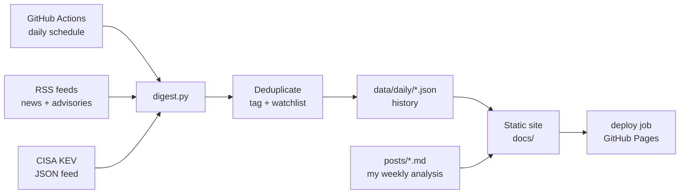

# Threat digest

An automated threat intelligence digest. Every morning it collects security news, vendor threat research, government advisories, and newly added **actively exploited vulnerabilities** (CISA KEV) from 18 sources. It removes duplicates, **groups the same story from different outlets into one entry**, tags items by topic, sector and regulation, highlights technology on my watchlist, and publishes a static website with filters and saved **profiles** (for example *Healthcare / HIPAA* or *SOC analyst*). Every week I add my own analysis of the most important stories.

**Live site:** https://dutchbug.github.io/threat-digest/

## Why I built this

- **Stay current.** Checking one page every morning beats scrolling ten news sites.
- **Practice analysis.** The weekly posts make me explain what happened, who is affected, how it maps to MITRE ATT&CK, and what defenders should do.
- **Build real skills:** Python, APIs and RSS, automation with GitHub Actions, static site generation, and secure handling of untrusted input.

## How it works



1. **Collect:** a scheduled GitHub Actions job runs `digest.py`, which downloads the RSS feeds and the CISA Known Exploited Vulnerabilities catalog.
2. **Process:** items older than the lookback window are skipped. Duplicates are removed: the same link with different tracking parameters counts as one item, and items published on earlier days are not shown again. Each item is tagged by keyword in three groups (**topics** such as ransomware or phishing, **sectors** such as healthcare or finance, and **regulations** such as HIPAA or PCI DSS), gets its source type (news, threat research, government, analysis), and is checked against my watchlist.
3. **Group stories:** when several outlets cover the same story, it's shown once with "Also covered by…". Two articles are grouped when they mention the same CVE ID, or when their headlines share at least 3 meaningful words with at least 40% overlap (common words like *attack*, *flaw* or *hackers* are ignored), published within 72 hours of each other. The main article comes from the source listed first in `config.yaml`.
4. **Store:** results are saved as JSON per day in `data/daily/`, so the history is versioned in Git.
5. **Publish:** the script generates the site in `docs/`, and the deploy job publishes it to GitHub Pages. Pages: today, last 7 days, archive, weekly analysis, about.
6. **Monitor:** each page shows a *Source status* panel: which feeds worked, how many new items each had, and the date of each feed's newest post. A feed whose newest post is over 30 days old is flagged as *stale* (the address probably changed). Timeouts and connection errors are retried once; one broken feed never stops the run.

## Filters and profiles

The filter panel narrows the list by topic, sector, regulation and source type, with a search box and a *watchlist only* switch.

- **Match any filter:** shows items that match any selected filter, for example *healthcare OR HIPAA*.
- **Match every group:** an item must match each group you used, for example *ransomware AND healthcare*.
- **Preset profiles** are defined in `config.yaml` (Healthcare / HIPAA, Payments / PCI DSS, GRC and compliance, SOC analyst, Microsoft 365 admin, Vulnerability management, Public sector and education, Threat research only).
- **My profiles:** select filters, name them, and save. They're stored in the browser (localStorage), so no account or backend is needed. The last used profile is re-applied on the next visit.
- **Shareable links:** the current filters are kept in the URL, so *Copy link* opens the same view on another device.
- **New since last visit:** items published since your previous visit get a *new* badge.
- **Compact view:** headlines only, for a quick scan. The setting is remembered.
- **Readability:** newest first with day separators on the *Last 7 days* page, watchlist matches marked with an amber edge, the 3 most relevant KEV entries shown with the rest behind *Show more*, and the detailed filters folded away with a summary of what's active.

Sector and regulation tags come from keyword matching. They're hints for triage, not a compliance assessment.

## Security considerations

This project processes content from the internet, so I treated all of it as untrusted:

- **Output encoding:** every value from a feed is HTML-escaped before it is placed in a page, to prevent cross-site scripting (XSS).
- **Link validation:** only `http`/`https` links are allowed, so a malicious feed can't inject `javascript:` links. CVE IDs are validated with a regex before they're used to build URLs.
- **Content Security Policy:** pages only load scripts and styles from the site itself; there are no inline scripts.
- **Safe embedding:** profile data is embedded as JSON with `<`, `>` and `&` escaped, so it can't break out of its script element.
- **Untrusted URL state:** filters read from a shared link are validated (only known fields, strings only, length-limited) and only used for comparisons, never inserted as HTML.
- **Privacy:** saved profiles and the last-visit time stay in the visitor's browser. The site has no tracking, cookies or backend.
- **Least privilege:** the workflow is read-only by default. The build job only gets `contents: write` (to commit data) and the deploy job only gets `pages: write` + `id-token: write`. Both jobs have timeouts.
- **No secrets:** version 1 needs no API keys. Any future keys go in GitHub Secrets, never in the code.
- **Copyright:** the site shows headlines and links to the original articles, not article text. Analysis is written in my own words.

Tests in `tests/fixtures/` include a malicious title, a `javascript:` link and a malformed CVE ID to check these protections, plus items for the sector/regulation tagging (and a check that generic words like "teams" don't get a Microsoft 365 tag).

## Project structure

```
digest.py                     collector + site generator
config.yaml                   sources, tags, watchlist, settings
posts/                        weekly analysis (Markdown); _template.md is the template
data/daily/YYYY-MM-DD.json    collected data per day
data/seen.json                published item IDs (dedupe, kept 30 days)
docs/                         generated website (GitHub Pages)
docs/app.js                   filters, profiles, shareable links, "new" badges
docs/style.css                styling (light and dark mode)
tests/fixtures/               fictional sample data for offline testing
.github/workflows/digest.yml  daily schedule
```

## Setup

1. Create a **public** repository named `threat-digest` and upload these files, including the hidden `.github` folder.
2. **Settings → Actions → General → Workflow permissions:** select *Read and write permissions*. This lets the job commit the digest.
3. **Settings → Pages:** set Source to **GitHub Actions**.
4. **Actions tab:** open *Daily threat digest* and click **Run workflow**. The `build` job collects the data and commits it; the `deploy` job publishes the site at `https://<username>.github.io/threat-digest/`.

After that, it runs every morning by itself.

### Run locally

```bash
python -m venv .venv
source .venv/bin/activate          # Windows: .venv\Scripts\activate
pip install -r requirements.txt

# Offline test with fictional sample data (doesn't touch the internet).
# Note: this writes test data to data/ and docs/. Don't commit it,
# or reset afterwards with: git checkout -- data docs  (and delete data/daily/2026-11-05.json)
python digest.py --fixtures tests/fixtures --now 2026-11-05T12:00:00Z

# Live run
python digest.py
```

Open `docs/index.html` in a browser to see the result.

## Writing a weekly post

1. Copy `posts/_template.md` to `posts/YYYY-MM-DD-short-title.md`.
2. Write the analysis in your own words, with links to sources.
3. Commit and push. The workflow rebuilds the site automatically.

## Customizing

Edit `config.yaml`:
- **feeds:** add or remove RSS/Atom sources, each with a `type` (news, research, government, analysis).
- **tags / sectors / regulations:** keywords per filter (whole-word, case-insensitive).
- **profiles:** preset filter sets shown in the Profile menu. Unknown names produce a warning in the run log.
- **watchlist:** technology to highlight.
- **lookback_hours / kev_days:** time windows.

## Changelog

- **v1.2:** story grouping across outlets ("3 sources", "Also covered by…"); source monitoring shows each feed's newest post and flags stale feeds; one retry on timeouts; readability: day separators, compact view, collapsible filters with active-filter summary, KEV "show more", section counts.
- **v1.1:** 18 sources with source types and a separate threat research section; sector and regulation tagging; filter panel with preset and custom profiles, shareable links and search; *Last 7 days* page; *new since last visit* badges; deployment through the workflow's own deploy job (least privilege per job). Removed CISA advisories (blocks automated requests from cloud servers; KEV data is still used) and the MSRC blog (invalid XML feed), both found through the Source status panel.
- **v1.0:** daily collection, KEV, tagging, watchlist, static site, weekly posts.

## Roadmap

- [ ] Alerts (email or Discord) when a watchlist item appears in KEV
- [ ] Trend page: KEV additions per month, top vendors, tag counts
- [ ] MITRE ATT&CK technique tagging
- [ ] **Version 2: AI-assisted summaries.** Short summaries and suggested tags, clearly labeled as AI-generated, always linking to the source. Feed text will be treated as untrusted input (prompt injection) and AI output will only be displayed, never used to trigger actions. Weekly analysis stays written by me.
- [ ] Pin GitHub Actions to commit SHAs (supply-chain hardening)

## Sources

See `config.yaml` or the About page for the full list. All content belongs to its respective publishers; this site only links to it.
