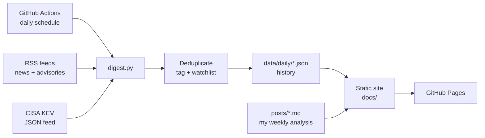

# Threat digest

An automated threat intelligence digest. Every morning it collects security news, security advisories, and newly added **actively exploited vulnerabilities** (CISA KEV). It removes duplicates, tags items by topic, highlights technology on my watchlist, and publishes a static website. Every week I add my own analysis of the most important stories.

**Live site:** `https://dutchbug.github.io/threat-digest/` *(update after enabling GitHub Pages)*

## Why I built this

- **Stay current.** Checking one page every morning beats scrolling ten news sites.
- **Practice analysis.** The weekly posts make me explain what happened, who is affected, how it maps to MITRE ATT&CK, and what defenders should do.
- **Build real skills:** Python, APIs and RSS, automation with GitHub Actions, static site generation, and secure handling of untrusted input.

## How it works



1. **Collect:** a scheduled GitHub Actions job runs `digest.py`, which downloads the RSS feeds and the CISA Known Exploited Vulnerabilities catalog.
2. **Process:** items older than the lookback window are skipped. Duplicates are removed: the same link with different tracking parameters counts as one item, and items published on earlier days are not shown again. Each item is tagged by keyword (ransomware, phishing, cloud/M365…) and checked against my watchlist.
3. **Store:** results are saved as JSON per day in `data/daily/`, so the history is versioned in Git.
4. **Publish:** the script generates the site in `docs/`, which GitHub Pages serves. Pages: today, archive, weekly analysis, about.
5. **Monitor:** each page shows a *Source status* panel listing which feeds worked. One broken feed doesn't stop the run.

## Security considerations

This project processes content from the internet, so I treated all of it as untrusted:

- **Output encoding:** every value from a feed is HTML-escaped before it is placed in a page, to prevent cross-site scripting (XSS).
- **Link validation:** only `http`/`https` links are allowed, so a malicious feed can't inject `javascript:` links. CVE IDs are validated with a regex before they're used to build URLs.
- **Content Security Policy:** pages only load scripts and styles from the site itself.
- **Least privilege:** the workflow token only has `contents: write`, and the job has a timeout.
- **No secrets:** version 1 needs no API keys. Any future keys go in GitHub Secrets, never in the code.
- **Copyright:** the site shows headlines and links to the original articles, not article text. Analysis is written in my own words.

Tests in `tests/fixtures/` include a malicious title, a `javascript:` link and a malformed CVE ID to check these protections.

## Project structure

```
digest.py                     collector + site generator
config.yaml                   sources, tags, watchlist, settings
posts/                        weekly analysis (Markdown); _template.md is the template
data/daily/YYYY-MM-DD.json    collected data per day
data/seen.json                published item IDs (dedupe, kept 30 days)
docs/                         generated website (GitHub Pages)
tests/fixtures/               fictional sample data for offline testing
.github/workflows/digest.yml  daily schedule
```

## Setup

1. Create a **public** repository named `threat-digest` and upload these files, including the hidden `.github` folder.
2. **Settings → Actions → General → Workflow permissions:** select *Read and write permissions*. This lets the job commit the digest.
3. **Actions tab:** open *Daily threat digest* and click **Run workflow** to create the first digest.
4. **Settings → Pages:** Source *Deploy from a branch*, Branch `main`, folder `/docs`. After a minute the site is live at `https://<username>.github.io/threat-digest/`.

After that, it runs every morning by itself.

### Run locally

```bash
python -m venv .venv
source .venv/bin/activate          # Windows: .venv\Scripts\activate
pip install -r requirements.txt

# Offline test with fictional sample data (doesn't touch the internet).
# Note: this writes test data to data/ and docs/. Don't commit it,
# or reset afterwards with: git checkout -- data docs  (and delete data/daily/2026-11-05.json)
python digest.py --fixtures tests/fixtures --now 2026-11-05T12:00:00Z

# Live run
python digest.py
```

Open `docs/index.html` in a browser to see the result.

## Writing a weekly post

1. Copy `posts/_template.md` to `posts/YYYY-MM-DD-short-title.md`.
2. Write the analysis in your own words, with links to sources.
3. Commit and push. The workflow rebuilds the site automatically.

## Customizing

Edit `config.yaml`:
- **feeds:** add or remove RSS/Atom sources.
- **tags:** topic keywords (whole-word, case-insensitive).
- **watchlist:** technology to highlight.
- **lookback_hours / kev_days:** time windows.

## Roadmap

- [ ] Alerts (email or Discord) when a watchlist item appears in KEV
- [ ] Trend page: KEV additions per month, top vendors, tag counts
- [ ] MITRE ATT&CK technique tagging
- [ ] **Version 2: AI-assisted summaries.** Short summaries and suggested tags, clearly labeled as AI-generated, always linking to the source. Feed text will be treated as untrusted input (prompt injection) and AI output will only be displayed, never used to trigger actions. Weekly analysis stays written by me.
- [ ] Pin GitHub Actions to commit SHAs (supply-chain hardening)

## Sources

CISA Known Exploited Vulnerabilities catalog, CISA advisories, Microsoft Security Response Center, Microsoft Security blog, BleepingComputer, The Hacker News, Krebs on Security, SANS Internet Storm Center. All content belongs to its respective publishers; this site only links to it.
